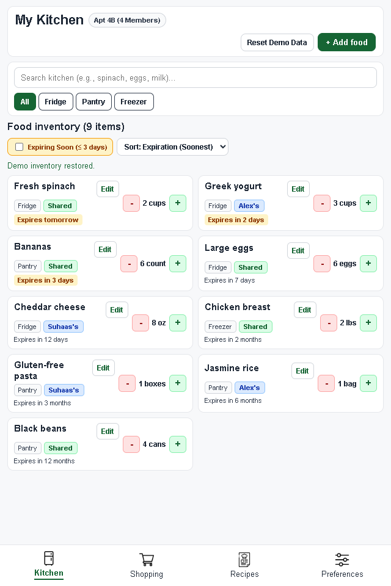
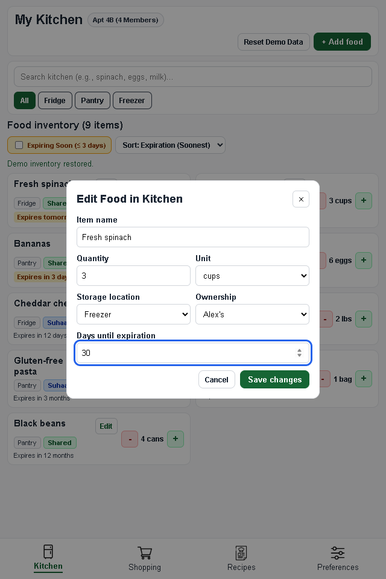
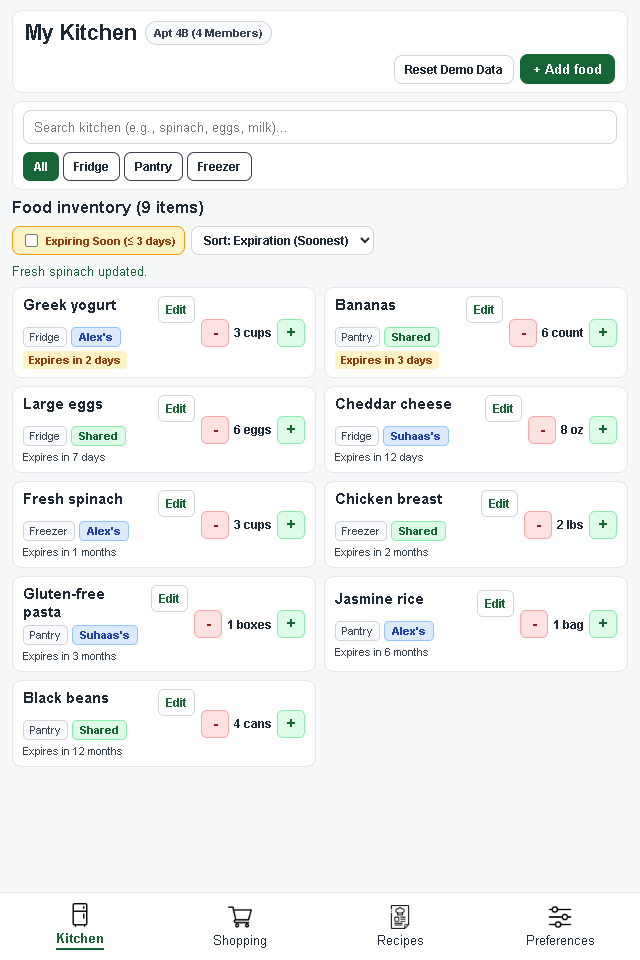

# Checkpoint contribution: inventory editing

Contributor: [Your name]

Implementation and draft prepared with Codex assistance. Review the behavior and wording before including this in the team submission.

## Contributions

- Added an Edit button to each food card in the Kitchen tab.
- Reused the existing food form to load an item's saved name, quantity, unit, storage location, ownership, and days until expiration.
- Added a Save changes action that updates the existing item and keeps the changes after a reload through local storage.
- Added Cancel, close, and Escape behavior that discards unsaved changes.
- Added validation for blank names and invalid numeric values, a confirmation message after saving, and keyboard focus handling for the dialog.
- Kept user-entered food names as literal text when rendering inventory cards.

## Task list addition

**Moderate task: Edit an existing food item's details.** A household member can correct information about an item already in the kitchen. For example, open Fresh spinach using its Edit button, change the quantity from 2 to 3 cups, change the storage location from Fridge to Freezer, assign ownership to Alex's, and change the expiration to 30 days. After saving, the inventory displays the updated values without adding another item. The changes remain after reloading the prototype.

This task requires selecting a record, entering information in a form, and saving it. It is classified as moderate; it does not introduce a multi-screen deep task. Cancel and Save are alternate outcomes of this task, not additional distinct tasks.

## Screenshots and captions

Kitchen inventory with an Edit action for each item. This is also the current initial screen.

Editing Fresh spinach using the existing food form. The screenshot shows proposed changes before saving.

Saved changes appear in the food card, the list reorders using the current expiration sort, and a confirmation message reports that Fresh spinach was updated. The inventory still contains nine items.

## Verification

Checked with an automated browser run in Microsoft Edge at 640x960 with network access disabled. The check covers prefilled values, saving without duplicates, reload persistence, cancel/close/Escape, keyboard focus, invalid inputs, filtering after an edit, and rendering HTML-like names as text. Existing Add Food, quantity, ownership, and reset interactions also passed. This is a development check, not a user study or a clean-machine Chrome compatibility test.

## Demo steps

1. Open `index.html` in a browser and select Reset Demo Data.
2. Select Edit on Fresh spinach.
3. Enter 3 cups, Freezer, Alex's, and 30 days until expiration.
4. Select Save changes and find the updated card. Expiration sorting moves it below the sooner-expiring foods.
5. Reload to verify that the changes persist.
6. Open Edit again, change a value, and select Cancel to demonstrate that unsaved changes are discarded.

The original inventory, layout, and navigation are Saad's existing work; this contribution extends that inventory with editing.
